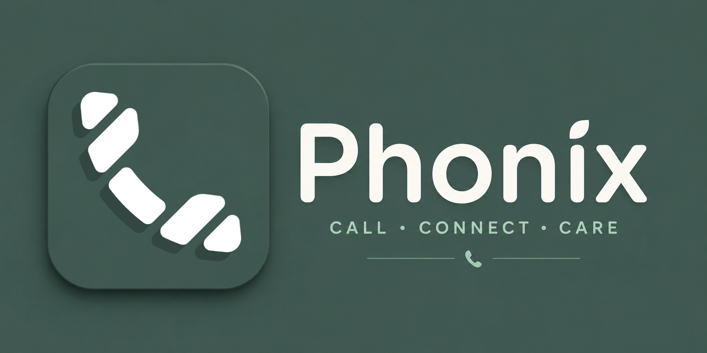

</img>

<h1 align="center">  Phonix</h1>

A clean, fast Android dialer with a built-in contact editor.

## Features

- **Minimal permissions, no ads:** only what a dialer needs, with no internet permission, no ads and no trackers
- **Everything a dialer should do:** make and receive calls, dial pad, call log, missed-call notifications, and a proper in-call screen
- **Dual-SIM ready:** pick the SIM before you call, and see which SIM each call used in your call history
- **Built-in contact viewer and editor:** view, add and edit contacts without leaving the app
- **Cool Material design:** clean Material 3 look with light and dark themes and an adaptive icon

## Acknowledgements

Phonix is a fork of [Koler](https://github.com/Chooloo/koler), and keeps much of its architecture and design. the pupose behind it to revive the app since developer maybe reject |he app.

Other open-source libraries used include Picasso, Dagger Hilt, AndroidX, Material Components, and the avatar view by Abdul Aris R.

## Development
This app is developed with the help of
- Claude AI — Coding assistance
- Termux (Android) — Version control and development
- GitHub Actions — Automated builds

No laptop or desktop computer was used in the development of this project.

## Copyright
Copyright (C) 2026 Md. Rasel Molla

Phonix is free software, released under the [GNU General Public License (GPL)](LICENCE), the same license as the original Koler. 
